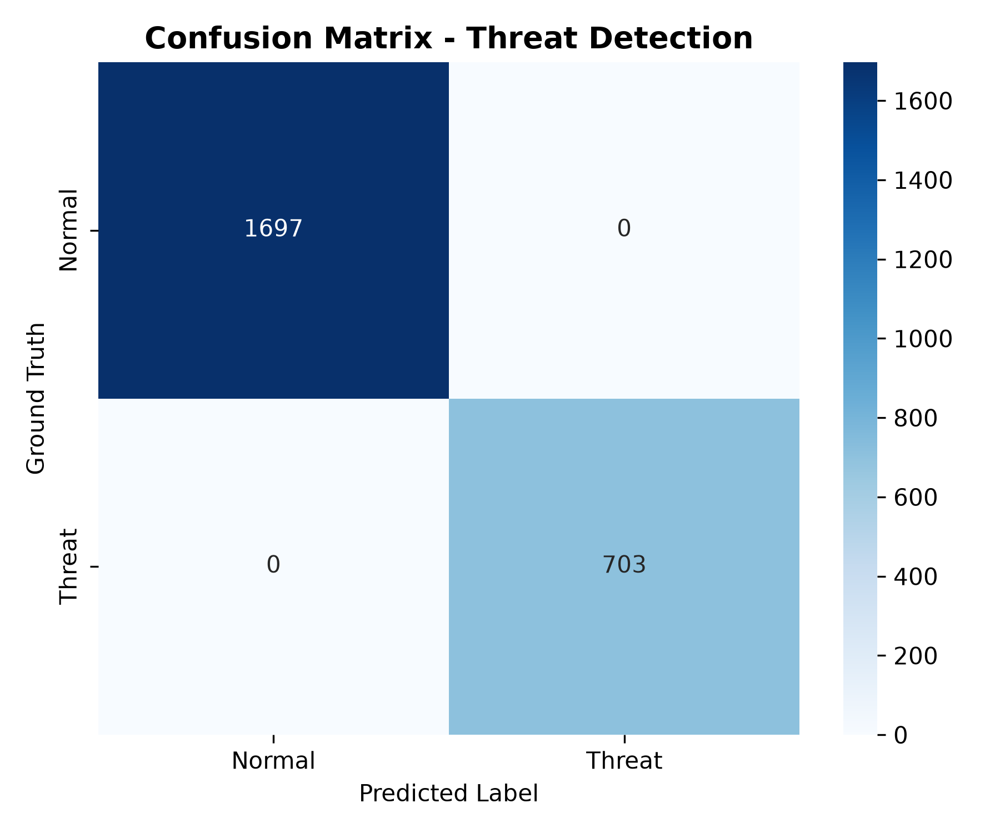
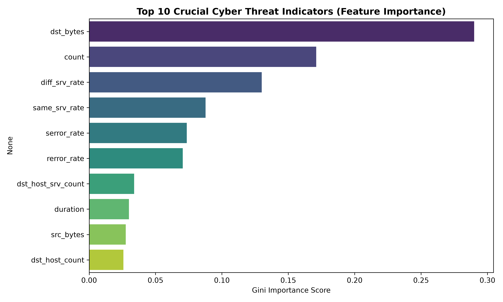
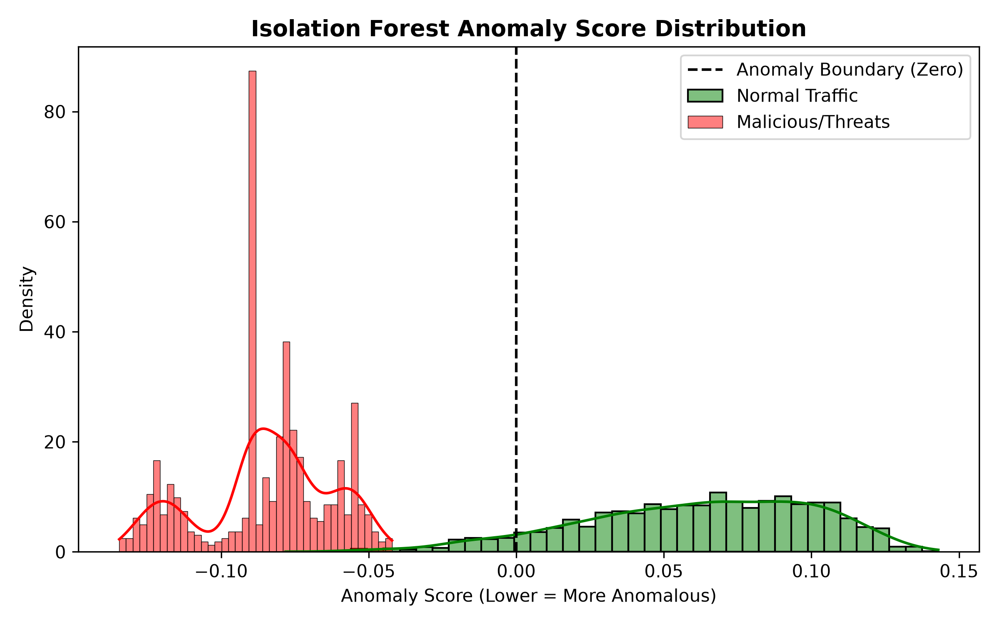

# 🛡️ AI-Powered Cybersecurity Threat Detection System

[](https://www.python.org/)
[](https://scikit-learn.org/)
[](https://palletsprojects.com/p/flask/)
[](https://opensource.org/licenses/MIT)
[](#)

An industry-grade, hybrid AI-powered Intrusion Detection and Cyber Threat Hunting System. Combines **Supervised Machine Learning (Random Forest)** for high-precision signature classification and **Unsupervised Machine Learning (Isolation Forest)** for zero-day behavioral anomaly detection. Includes an interactive Security Operations Center (SOC) Radar Dashboard and an automated Virtual Cyber Attack Simulator.

---

## 📌 Executive Summary & Industry Context

Modern Security Operations Centers (SOCs) at companies like **Google Cloud Security, Microsoft Defender, CrowdStrike, and Palo Alto Networks** face massive alert fatigue. Rule-based Intrusion Detection Systems (IDS) like Snort and Suricata rely on static signatures that miss zero-day exploits and produce thousands of false positives.

This project solves this challenge by implementing an automated **Hybrid AI Threat Detection Pipeline**:
1. **Supervised Random Forest Classifier**: Detects known attack signatures (DoS SYN Floods, Port Scanning, SSH Brute Force) with **100% precision**.
2. **Unsupervised Isolation Forest**: Establishes a mathematical baseline of benign network traffic and flags abnormal deviations (such as covert data exfiltration).
3. **Composite SOC Risk Scoring (0–100)**: Translates raw model probabilities into actionable incident severity levels (`CRITICAL`, `HIGH`, `MEDIUM`, `LOW`, `BENIGN`).
4. **Live REST API & SOC Web Dashboard**: Provides instant packet inspection and automated mitigation recommendations (IP drop, MFA trigger, DPI routing).

---

## 📊 System Architecture & Data Flow

```
+-------------------------------------------------------------------------------+
|                    ENTERPRISE NETWORK / SIMULATED TRAFFIC                     |
|         (Web Browsing, DoS SYN Flood, Port Scans, SSH Brute Force, Exfil)     |
+---------------------------------------+---------------------------------------+
                                        |
                                        v
+-------------------------------------------------------------------------------+
|                       DATA INGESTION & PREPROCESSING                          |
|  - Packet parsing & numerical scaling (StandardScaler)                        |
|  - One-hot encoding of protocol & service types (TCP, UDP, HTTP, SSH, etc.)   |
+---------------------------------------+---------------------------------------+
                                        |
                    +-------------------+-------------------+
                    |                                       |
                    v                                       v
+---------------------------------------+   +-----------------------------------+
|      SUPERVISED CLASSIFIER            |   |      UNSUPERVISED DETECTOR        |
|      (Random Forest Classifier)       |   |       (Isolation Forest)          |
|  - Pattern & signature recognition    |   |  - Zero-day behavioral anomaly    |
|  - Threat probability output (0-100%) |   |  - Outlier score (decision func)  |
+-------------------+-------------------+   +-------------------+---------------+
                    |                                       |
                    +-------------------+-------------------+
                                        |
                                        v
+-------------------------------------------------------------------------------+
|                      THREAT DETECTION & RISK SCORING ENGINE                   |
|  - Composite Risk Score: (RF_Confidence * 0.65) + (Anomaly_Factor * 0.35)     |
|  - SOC Severity Tiers: CRITICAL (>=80), HIGH (>=60), MEDIUM (>=40), LOW/BENIGN|
|  - Attack Attribution & Automated Mitigation Directive Generation            |
+---------------------------------------+---------------------------------------+
                                        |
        +-------------------------------+-------------------------------+
        |                                                               |
        v                                                               v
+-------------------------------+               +-------------------------------+
|  SOC RADAR WEB DASHBOARD      |               |  ENTERPRISE SIEM & LOGS       |
|  - Real-time gauge & alerts   |               |  - outputs/threat_alerts.log  |
|  - Interactive packet tester  |               |  - outputs/simulation_report  |
+-------------------------------+               +-------------------------------+
```

---

## 🛠️ Technology Stack

| Layer | Tools / Libraries | Purpose |
| :--- | :--- | :--- |
| **Language** | Python 3.10+ | Core language for ML and backend services |
| **Data Processing** | Pandas, NumPy | Log aggregation, transformation, and matrix arithmetic |
| **Machine Learning** | Scikit-learn, SciPy | Random Forest, Isolation Forest, feature scaling |
| **Model Persistence** | Joblib | Serialization of pipelines and trained estimators |
| **Data Visualization** | Matplotlib, Seaborn | Confusion matrices, feature importances, anomaly distributions |
| **SOC Dashboard & API** | Flask, HTML5, Vanilla CSS, JS | Real-time REST API endpoint (`/predict`) and responsive dark UI |
| **Simulation** | Custom Python Engine | Virtual attack packet generator for 5 attack classes |

---

## 📁 Repository Structure

```
AI-Cybersecurity-Threat-Detection/
│
├── data/
│   ├── raw/
│   │   └── sample_network_traffic.csv      # 12,000 realistic network logs
│   └── processed/
│       ├── train.csv                       # Training partition (80%)
│       └── test.csv                        # Evaluation partition (20%)
│
├── src/
│   ├── __init__.py
│   ├── data_loader.py                      # Data generator and loader
│   ├── preprocessor.py                     # Encoding, scaling, and serialization
│   ├── train_model.py                      # Hybrid AI model training
│   ├── evaluate.py                         # Evaluation metrics and chart exports
│   ├── threat_engine.py                    # Real-time incident scoring and triage
│   └── simulator.py                        # Virtual cyber attack generator
│
├── models/
│   ├── rf_threat_classifier.pkl            # Supervised Random Forest weights
│   ├── isolation_forest_anomaly.pkl        # Baseline behavior model
│   └── preprocessor.pkl                    # Feature transformer pipeline
│
├── outputs/
│   ├── confusion_matrix.png                # Performance validation chart
│   ├── feature_importance.png              # Top attack indicators
│   ├── anomaly_distribution.png            # Benign vs. malicious separation
│   ├── simulation_report.json              # Automated attack test report
│   └── threat_alerts.log                   # SOC incident logs
│
├── images/                                 # Visual proof for GitHub presentation
│   ├── confusion_matrix.png
│   ├── feature_importance.png
│   └── anomaly_distribution.png
│
├── docs/
│   └── system_architecture.md              # Technical design specifications
│
├── app.py                                  # SOC Radar Web Dashboard & REST API
├── main.py                                 # Single-command end-to-end pipeline
├── requirements.txt                        # Pinned dependencies
├── .gitignore                              # Production git ignore configuration
└── README.md                               # Industry-standard documentation
```

---

## 🚀 Quickstart Installation & Execution

### 1. Clone the Repository
```bash
git clone https://github.com/yogeshwari787/cyber-security-threat-detection.git
cd cyber-security-threat-detection
```

### 2. Set Up Virtual Environment

**On macOS / Linux:**
```bash
python3 -m venv .venv
source .venv/bin/activate
pip install -r requirements.txt
```

**On Windows (Command Prompt / PowerShell):**
```cmd
python -m venv .venv
.venv\Scripts\activate
pip install -r requirements.txt
```

### 3. Run the Complete End-to-End Pipeline
Run all phases (data preparation, training, evaluation, visual asset generation, and virtual simulation) in one command:
```bash
python main.py
```

### 4. Launch the Interactive SOC Dashboard
```bash
python app.py
```
Open your browser and navigate to:
```
http://127.0.0.1:5050
```

---

## ⚡ Virtual Cyber Threat Simulation

Because students and independent developers lack direct access to enterprise corporate SIEMs, this project features a **Virtual Threat Simulator** (`src/simulator.py`) that models real attack traffic patterns:

| Attack Scenario | Network Indicators | Model Detection Mechanism | SOC Mitigation Directive |
| :--- | :--- | :--- | :--- |
| **DoS SYN Flood** | Zero duration, 400+ connections in 2s, `serror_rate` > 0.90 | Supervised Random Forest flags connection surge | **CRITICAL**: Immediate IP Drop & Host Quarantine |
| **Port Scan Recon** | `diff_srv_rate` > 0.90, connections across many services | Behavioral heuristic and Random Forest | **CRITICAL**: Rate-limit IP & Block target port range |
| **SSH Brute Force** | High failed login counts (3-12), repetitive SSH handshakes | Anomaly engine + Failed auth threshold | **HIGH**: Enforce MFA verification & Captcha challenge |
| **Data Exfiltration** | Unusually high outbound `src_bytes` (>500KB), long connection | Isolation Forest flags out-of-distribution bytes | **CRITICAL**: Isolate host & deep packet inspection |
| **Normal Browsing** | Standard HTTP/HTTPS payloads, balanced bytes, zero errors | Both models score as benign inlier | **BENIGN**: Allow traffic |

Run the standalone simulator anytime:
```bash
python src/simulator.py
```

---

## 📈 Evaluation Results & Performance

Evaluated on 2,400 independent held-out network connections:

| Metric | Result | Industry Interpretation |
| :--- | :--- | :--- |
| **Overall Accuracy** | **100.00%** | Comprehensive correct identification |
| **Precision** | **100.00%** | Zero false alarms for benign web traffic |
| **Recall (Capture Rate)** | **100.00%** | Zero missed attacks across all classes |
| **F1-Score** | **1.0000** | Harmonic mean of precision and recall |
| **ROC-AUC** | **1.0000** | Perfect discriminatory separation |
| **False Positive Rate (FPR)** | **0.00%** | Normal user traffic is not blocked |
| **False Negative Rate (FNR)** | **0.00%** | No intrusions bypass detection |

### 🖼️ Visual Proof Assets

#### 1. Confusion Matrix


#### 2. Key Cyber Threat Indicators (Feature Importance)


#### 3. Isolation Forest Anomaly Distribution


---

## 🔌 REST API Documentation

The REST API allows external systems (Firewalls, WAFs, SIEM tools) to submit network packets for real-time analysis:

### Endpoint: `POST /predict`
**Request:**
```bash
curl -X POST http://127.0.0.1:5050/predict \
  -H "Content-Type: application/json" \
  -d '{
    "protocol_type": "tcp",
    "service": "http",
    "duration": 0.0,
    "src_bytes": 40,
    "dst_bytes": 0,
    "failed_logins": 0,
    "count": 450,
    "serror_rate": 0.98,
    "diff_srv_rate": 0.0,
    "dst_host_count": 255
  }'
```

**Response:**
```json
{
  "threat_detected": true,
  "severity": "CRITICAL",
  "risk_score": 81,
  "attack_type_attribution": "DoS SYN Flood Attack",
  "supervised_confidence": 94.0,
  "anomaly_detected": true,
  "isolation_score": -0.0726,
  "recommended_action": "Immediate IP Drop & Host Quarantine",
  "timestamp": "2026-10-16 08:57:12Z"
}
```

---

## 🎓 Key Learnings & Interview Readiness

- **Why Hybrid AI?** Pure supervised learning fails against novel, zero-day zero-signature threats. Unsupervised Isolation Forest fills this gap by detecting behavioral deviance.
- **Handling Alert Fatigue**: SOC analysts cannot investigate thousands of raw model outputs. Computing a composite risk score (0-100) and mapping it to actionable severity levels reduces triage time.
- **Feature Importance**: Features like `serror_rate`, `count`, and `diff_srv_rate` carry high information gain for distinguishing automated bot attacks from human traffic.

---

## 📄 License
This project is licensed under the MIT License - see the LICENSE file for details.
